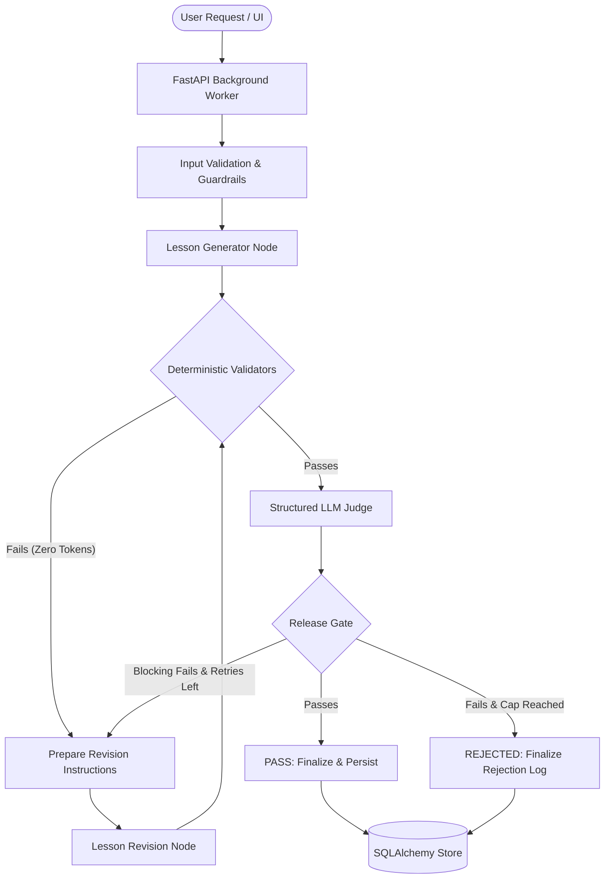

Status: implemented

# Architecture Documentation

## Overview
The Learn Loop engine is an autonomous educational content creation system. It combines a generative pipeline with deterministic and model-judged evaluation gates within a closed-loop state machine.

## System Components
1. **Frontend UI Process (`ui/app.py`, `ui/api_client.py`)**: Built with NiceGUI. It runs as an independent process communicating strictly over HTTP. Zero generation, evaluation, or database logic exists in the UI.
2. **Backend API Process (`api/main.py`, `api/routes.py`)**: Built with FastAPI. Dispatches runs to background workers, exposes REST endpoints for state polling, cancellation, feedback, metrics, and health probes.
3. **State Machine (`agent/graph.py`, `agent/nodes.py`)**: Orchestrated using LangGraph. Implements state transitions with deterministic short-circuiting to skip LLM judge calls when zero-token deterministic checks fail.
4. **Deterministic Evaluation (`evaluation/validators.py`)**: 7 zero-token validators inspecting schema integrity, word counts, Flesch-Kincaid readability, jargon glossaries, worked example presence, code syntax (AST), and citation grounding.
5. **LLM Judge (`evaluation/judge.py`)**: Combined structured extraction evaluating 6 pedagogical criteria and extracting claim grounding objects.
6. **Release Gate (`guardrails/release_gate.py`)**: Pure deterministic function evaluating the rubric truth table.
7. **Memory & Persistence (`memory/store.py`)**: SQLAlchemy models storing runs, version snapshots, evaluations, rejection audit trails, token usage, and user feedback.

## How to modify this
To modify this architecture document, ensure `Status: implemented` remains on line 1 and keep the Mermaid workflow diagram updated to reflect any state graph or component alterations.
